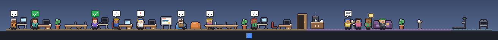

# Taskbar Office for Orca

[English](README.md) | **한국어**



Windows 작업표시줄 바로 위에 사는 픽셀아트 사무실입니다. [Orca](https://orca.dev) 에이전트 세션 하나가 캐릭터 한 명입니다. 일할 때는 책상에 앉아 있고, 내 응답이 필요하면 손을 흔들고, 작업이 끝나면 내가 결과를 확인할 때까지 초록 체크를 달고 기다립니다. 확인하고 나면 라운지로 가서 커피를 마십니다.

> **Orca 공식 프로젝트가 아닙니다.** Orca CLI의 출력을 읽어 동작하므로, Orca 업데이트로 출력이 바뀌면 동작하지 않을 수 있습니다.

## 특징

- **곁눈질로 확인**: 작업표시줄 위에 항상 떠 있는 얇은 띠입니다. 빈 공간은 클릭이 뒤 창으로 통과합니다.
- **세션마다 캐릭터 한 명**: 작업 중, 응답 대기, 완료, 실패, 중단이 각각 다르게 보입니다.
- **결과는 확인할 때까지 남음**: 끝난 캐릭터는 클릭하거나 Orca에서 그 세션을 읽을 때까지 자리에서 표시를 달고 기다립니다.
- **클릭해서 이동**: 캐릭터를 클릭하면 Orca에서 그 워크스페이스가 열립니다.
- **원격 환경**: Orca 원격 환경의 세션도 같은 사무실에 나옵니다.

## 필요한 것

- Windows 10 또는 11
- 실행 중인 [Orca](https://orca.dev) 데스크톱 앱 (1.4.255에서 확인)

## 설치

[Releases](https://github.com/syjeon121/orca-taskbar-office/releases)에서 `Taskbar Office Setup <버전>.exe`를 받아 실행합니다. 코드 서명이 없어서 Windows가 "알 수 없는 게시자" 경고를 띄울 수 있습니다.

소스에서 실행하려면 (Node.js 24):

```powershell
npm install
npm start
```

## 화면 읽는 법

| 세션 | 캐릭터 | 말풍선 |
|---|---|---|
| 작업 중 | 오피스 자리에서 타이핑 | 사용 중인 도구 아이콘과 `...` |
| 응답 대기 | 자리에서 손 흔들기 | 빨간 `!` |
| 완료 | 만세 후 확인할 때까지 자리에서 대기 | 초록 바탕의 흰 체크 |
| 실패 / 중단 | 머리를 긁적인 뒤 자리에서 대기 | 빨간 `X` / 회색 일시정지 |
| 쉬는 중 | 라운지에서 커피, 수다, 소파, 운동 | 수다 중에는 줄글 말풍선 |

캐릭터에 커서를 올리면 자세한 정보가 뜨고, 클릭하면 Orca에서 워크스페이스가 열립니다. 설정은 트레이 아이콘 메뉴에 있습니다. 화면 언어는 기본이 영어이고, 트레이 메뉴의 "Language"에서 한국어로 바꿀 수 있습니다.

## 문서 (영문)

- [Usage](docs/usage.md): 조작, 트레이 메뉴, 설정, 원격 환경, 알려진 제약
- [Development](docs/development.md): 프로젝트 구조, Orca 데이터 대응, 개발용 옵션, 설치 파일 만들기

## 라이선스

[MIT](LICENSE)
