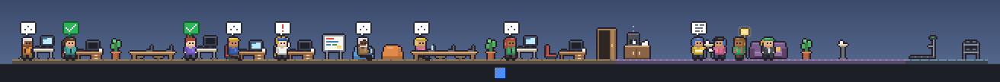

# Taskbar Office for Orca

**English** | [한국어](README.ko.md)



A pixel-art office that lives just above your Windows taskbar. Every [Orca](https://orca.dev) agent session is a little worker: they sit at a desk while working, wave when they need you, and wait with a green check until you look at the result. Then they head to the lounge for coffee.

> **Not an official Orca project.** Taskbar Office reads the output of the Orca CLI, so an Orca update that changes that output may break it.

## Features

- **Glanceable**: a thin, always-on-top strip above the taskbar. Empty space is click-through.
- **One character per session**: working, waiting for you, done, failed and interrupted each look different.
- **Results wait for you**: a finished character stays at its desk with its mark until you click it or read the session in Orca.
- **Click to jump**: clicking a character opens its workspace in Orca.
- **Remote environments**: sessions from remote Orca environments show up in the same office.

## Requirements

- Windows 10 or 11
- [Orca](https://orca.dev) desktop app, running (tested with 1.4.255)

## Install

Download `Taskbar Office Setup <version>.exe` from [Releases](https://github.com/syjeon121/orca-taskbar-office/releases) and run it. The installer isn't code-signed, so Windows may show an "unknown publisher" warning.

To run from source (Node.js 24):

```powershell
npm install
npm start
```

## What you see

| Session | Character | Bubble |
|---|---|---|
| Working | Types at a desk in the office | Current tool icon and `...` |
| Waiting for you | Waves at the desk | Red `!` |
| Done | Cheers, then waits at the desk until you check | White check on green |
| Failed / interrupted | Scratches head, then waits at the desk | Red `X` / gray pause |
| Resting | Coffee, chats, sofa or gym in the lounge | Speech lines while chatting |

Hover a character for details, click it to open the workspace in Orca. Settings, including the UI language (English, Korean), live in the tray icon menu.

## Docs

- [Usage](docs/usage.md): controls, tray menu, settings, remote environments, limitations
- [Development](docs/development.md): project structure, Orca data mapping, dev flags, building the installer

## License

[MIT](LICENSE)
